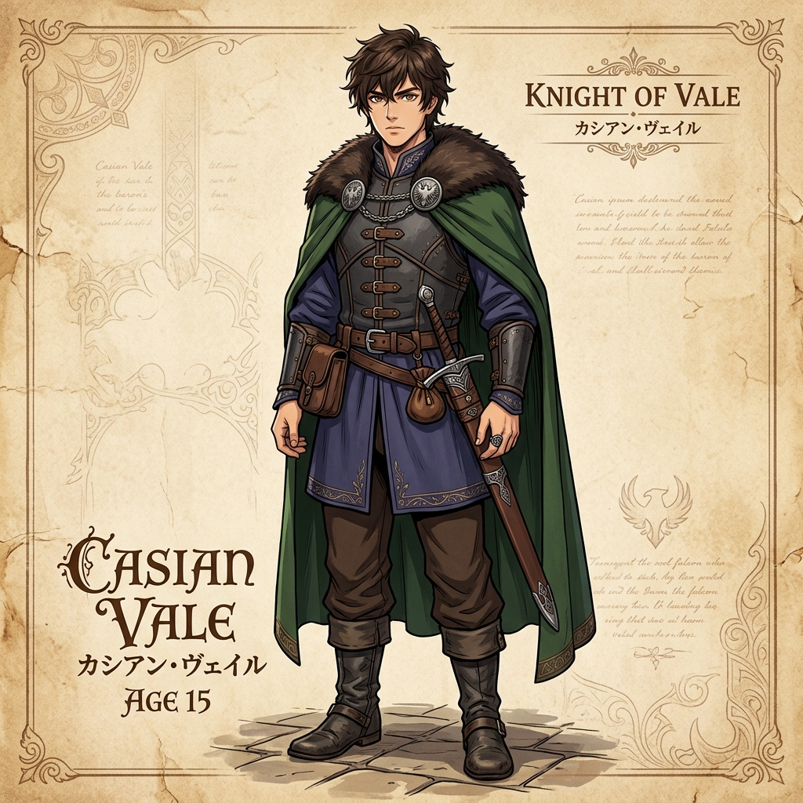
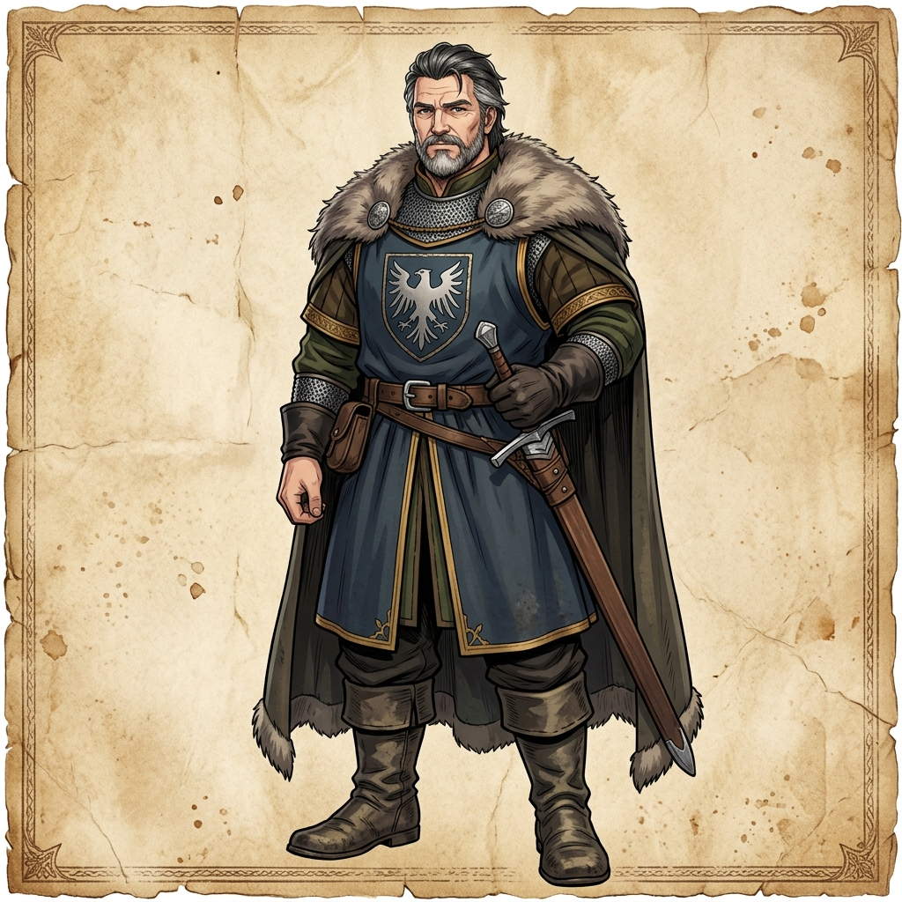
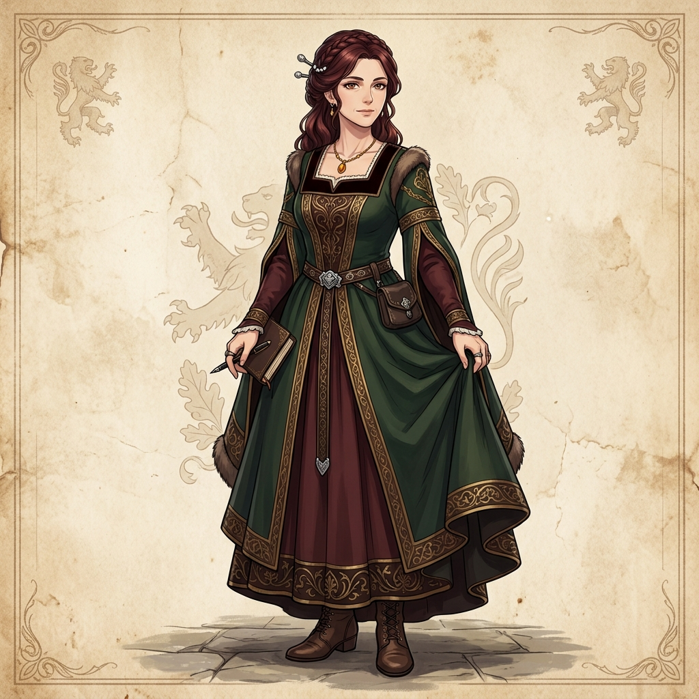
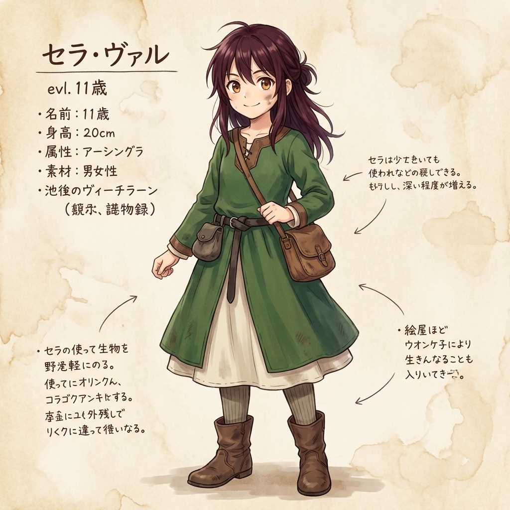
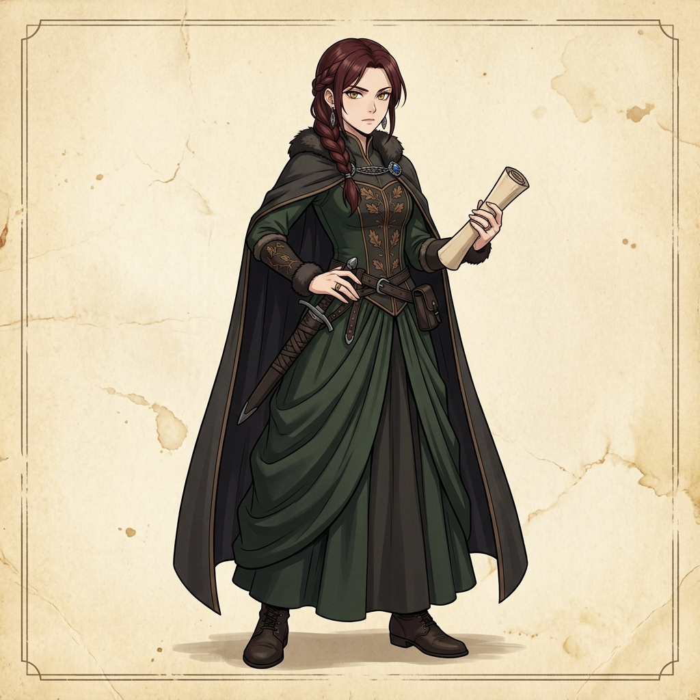
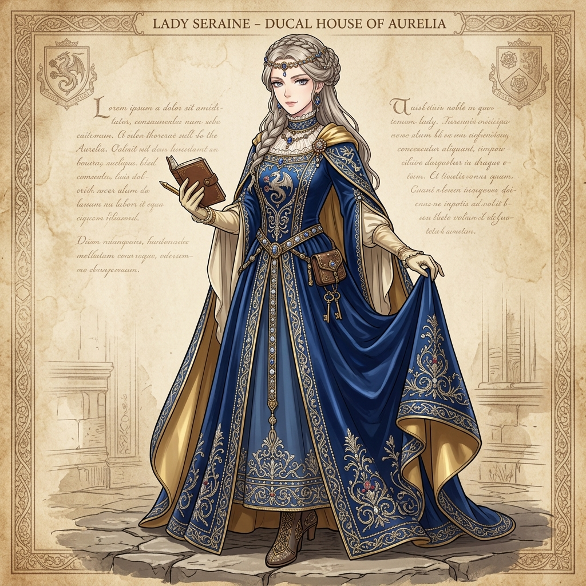
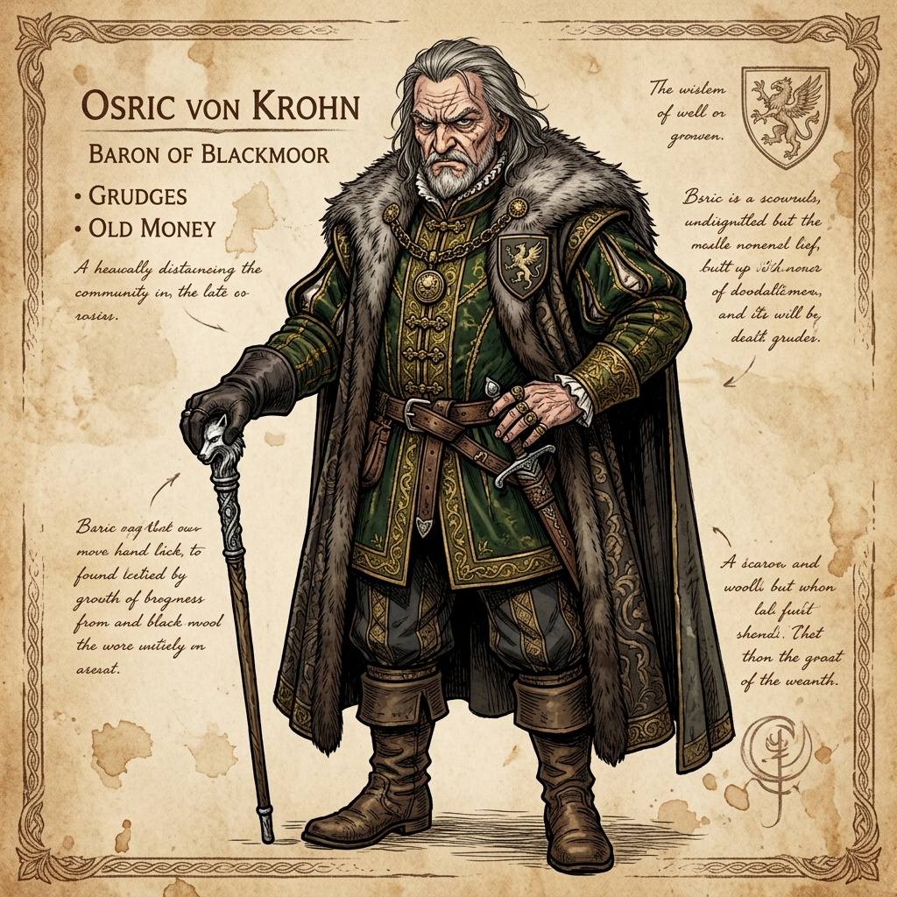

# Volume 1 - Character Sheet

This document serves as the official character reference sheet for **Volume 1** of the light novel.

## The Vale Family

### Casian Vale (Protagonist)
**Age:** 15
The 4th son of the Vale barony. He appears to be a lazy, gardening enthusiast, but secretly runs the barony from the shadows with cold, modern efficiency.

### Lord Edric Vale
**Age:** 45
The steady, duty-first Baron of Vale. He lets his son Casian implement "improvements" without asking too many questions, maintaining stability in the region.

### Lady Maren Vale
**Age:** 41
The perceptive and patient Baroness of Vale. She is the emotional center of the family and frequently shares a quiet bond with Casian over cooking.

### Elna Vale
**Age:** 11
Casian's bright and curious younger sister. Often found trailing him in the garden with dirt on her cheeks. She is his most obvious soft spot.

## Neighbouring Nobles & Key Figures

### Baroness Calla of Fenwick
A young, competent widow running her own estate. She becomes increasingly curious about the anomalous prosperity of the Vale barony and often visits.

### Lady Seraine Varyn
The sharp, politically trained daughter of Royal Duke Varyn. She expects a typical noble boy but finds herself intrigued by Casian's unnerving competence.

### Baron Osric of Thornwall
An older baron clinging to old money and grudges. The vocal, disgruntled antagonist of Volume 1 who blames the Vale barony for disrupting the regional order.

